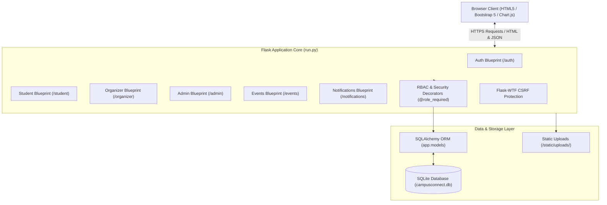
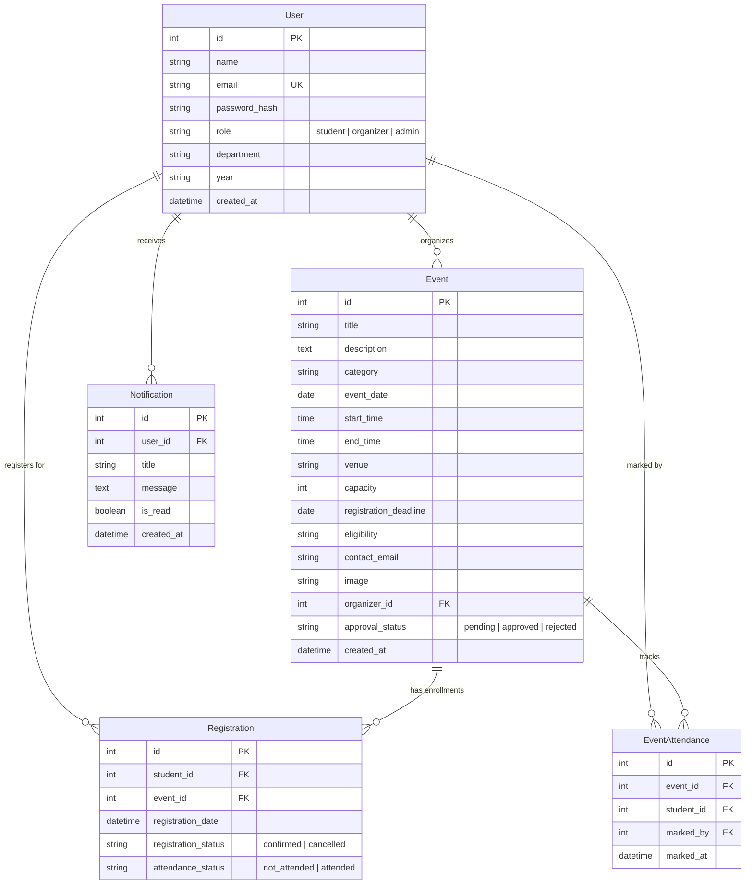

# CampusConnect - College Event Management Web Application
> *"Your Campus. Your Events. Your Community."*

[](https://www.python.org/)
[](https://flask.palletsprojects.com/)
[](https://www.sqlalchemy.org/)
[](https://getbootstrap.com/)
[](https://docs.pytest.org/)

---

## 1. Project Introduction

**CampusConnect** is a centralized college event management web application developed from scratch as a practical full-stack engineering project. It eliminates scattered event announcements, chaotic registration processes, paper notices, and uncoordinated communication across academic departments, student clubs, and college administration.

The application brings students, event organizers, and college administrators into a unified digital workspace featuring secure authentication, strict Role-Based Access Control (RBAC), multi-criteria event discovery, real-time seat tracking, automated capacity limits, check-in attendance management, CSV reporting, and in-app notifications.

---

## 2. Problem Statement & Objectives

### The Problem
* **Fragmented Announcements:** College events are traditionally announced over disparate WhatsApp groups, paper notice boards, and unorganized email threads.
* **Manual Registrations:** Google Forms or paper sheets lead to duplicate registrations, exceeding hall capacities, and manual tallying errors.
* **Lack of Accountability:** Difficult to track actual attendee turnouts, no standard attendance check-ins, and absence of historical participation records.
* **Administrative Overhead:** College authorities have no single dashboard to review, approve, moderate, or analyze student engagement across campus.

### Core Objectives
1. **Centralize:** Provide a single source of truth for all campus technical, cultural, sports, and academic activities.
2. **Automate:** Enforce automated capacity constraints, duplicate registration checks, and deadline validations at the database and application level.
3. **Empower Organizers:** Give student clubs and faculty organizers intuitive tools to publish events, track enrollments in real time, mark digital attendance, and export participant data.
4. **Oversee Governance:** Provide college leadership with moderation controls and Chart.js analytics on student participation and category distributions.

---

## 3. System Architecture

CampusConnect follows a clean Model-View-Controller (MVC) architectural pattern leveraging Flask Blueprints for modular route segregation.



---

## 4. Database Schema & Entity Relationships

The data model uses SQLAlchemy ORM with foreign key cascades, indexes, and a unique constraint preventing duplicate student registrations (`uq_student_event`).



---

## 5. Technology Stack

| Layer | Technologies |
| :--- | :--- |
| **Backend** | Python 3, Flask 3.1.3, Flask-SQLAlchemy 3.1.1, Flask-Login 0.6.3, Flask-WTF 1.3.0, Werkzeug 3.1.9, python-dotenv |
| **Frontend** | HTML5, CSS3, JavaScript (ES6), Bootstrap 5.3.3, Bootstrap Icons 1.11.3, Google Fonts (Plus Jakarta Sans & Inter) |
| **Analytics** | Chart.js 4.4.2 (Interactive Bar, Line, and Doughnut charts) |
| **Database** | SQLite 3 via SQLAlchemy (easily migratable to PostgreSQL or MySQL) |
| **Image Processing** | Pillow (PIL) for safe cover image generation & upload processing |
| **Testing** | Pytest 9.2.0 |

---

## 6. User Roles and Capabilities

### A. Student
* Create account, sign in, sign out, and update profile (academic year, department, password).
* Browse upcoming and past events with keyword search, category filter, date filter, venue filter, and sorting.
* View event details (agenda, eligibility, venue, seats left, organizer contact).
* One-click event registration with automated eligibility, deadline, and capacity validations.
* Self-service registration cancellation before event commencement.
* Dedicated **Student Dashboard** showing registered events, past attended events, and alerts.
* View personal attendance badges (*Attended* / *Not Attended*).

### B. Event Organizer
* Create events with cover image upload, venue, capacity, deadlines, and eligibility criteria.
* New events start with **Pending** status awaiting college administrative approval.
* Dedicated **Organizer Dashboard** tracking active events, pending approvals, and student enrollments.
* Manage, edit, or cancel hosted events (automatic cancellation notifications sent to registered students).
* View attendee roster with real-time fill rates.
* One-click digital check-in to mark attendance (*Attended* / *Not Attended*).
* Export attendee rosters as CSV files for official records.
* View **Organizer Analytics** with Chart.js showing capacity fill rates and category distributions.

### C. Administrator
* Centralized **Admin Dashboard** with high-level platform statistics and metrics.
* 4 interactive Chart.js visualizations:
  1. Monthly Event Creation Trends
  2. Event Category Distribution
  3. Monthly Student Registrations
  4. Top Events by Student Participation
* Moderate all campus events: 1-click **Approve**, **Reject** with reason, or **Delete**.
* User directory: view all student and organizer accounts, filter by role/department, reassign roles, or remove accounts.
* Global registrations monitor across all college departments.

### D. In-App Notification System
* Automatic triggers when an event is submitted, approved, rejected, updated, or cancelled.
* Real-time notifications for students upon successful registration or cancellation.
* Notifications for organizers whenever a student enrolls or cancels.
* Unread counter badge in top navigation with 1-click "Mark All as Read" action.

---

## 7. Installation & Setup Guide (Windows PowerShell)

Follow these exact commands in Windows PowerShell:

### Step 1: Open the Project Directory
```powershell
cd "c:\Users\AYAN GAMING\OneDrive\Desktop\cc"
```

### Step 2: Create and Activate Virtual Environment
```powershell
python -m venv .venv
.\.venv\Scripts\Activate.ps1
```

*(If script execution is disabled on your system, run `Set-ExecutionPolicy -ExecutionPolicy RemoteSigned -Scope CurrentUser` once).*

### Step 3: Install Required Dependencies
```powershell
pip install -r requirements.txt
```

### Step 4: Configure Environment Variables
Copy `.env.example` to `.env` (already created):
```powershell
Copy-Item .env.example .env
```

### Step 5: Seed the Database with Realistic Demo Data
Run the seeding script to create database tables, sample events, users, registrations, and banners:
```powershell
python seed.py
```

### Step 6: Run the Web Application
```powershell
python run.py
```

Open your web browser and navigate to:
```
http://127.0.0.1:5000/
```

---

## 8. Running Automated Tests

A comprehensive test suite of 15 automated test cases is included in the `tests/` directory covering:
* User registration & password hashing
* User login authentication & invalid credentials handling
* Role-based access control (RBAC) restrictions
* Event creation workflow (starts in pending status)
* Event editing and permission verification
* Unauthorized cross-organizer event modification protection
* Administrative event approval workflow
* Student event registration
* Duplicate registration prevention
* Event capacity limit enforcement
* Registration cancellation workflow
* In-app notification creation and mark-as-read flow

To run the complete test suite:
```powershell
.\.venv\Scripts\pytest -v
```

Expected result:
```
====================== 15 passed in 40.14s ======================
```

---

## 9. Vercel Deployment Configuration

CampusConnect is pre-configured for zero-friction deployment on the **Vercel Serverless Python Runtime**:

* **Serverless Entrypoint:** `api/index.py` (exports the canonical `app` WSGI instance)
* **WSGI Root Entrypoint:** `wsgi.py` (WSGI standard entrypoint)
* **Routing Rewrites:** `vercel.json` rewrites all incoming traffic `/(.*)` to `/api/index`
* **Entrypoint Specification:** `pyproject.toml` explicitly sets `[tool.vercel] entrypoint = "api/index.py"`
* **Build Exclusions:** `.vercelignore` excludes development scripts (`seed.py`), unit tests (`tests/`), and virtual environments (`.venv/`) so Vercel's framework detector never mistakes them for entrypoints.
* **Serverless Writable Storage:** `config.py` detects `VERCEL=1` and ensures writable storage in `/tmp` for SQLite and dynamic uploads.

### Deploying to Vercel:
```bash
# Using Vercel CLI
vercel

# Or push your GitHub repository and import the project in the Vercel Dashboard
```

---

## 10. Project Directory Structure

```
campusconnect/
│
├── api/
│   └── index.py             # Vercel Serverless Function entry point
├── app/
│   ├── __init__.py          # Flask application factory, blueprints & context processors
│   ├── extensions.py        # SQLAlchemy, LoginManager, CSRFProtect instances
│   ├── models.py            # User, Event, Registration, Notification, EventAttendance models
│   ├── forms.py             # Flask-WTF forms with custom server-side validators
│   ├── utils.py             # Role decorators (@role_required), file upload & notification helpers
│   │
│   ├── auth/                # Authentication blueprint (Login, Register, Logout, Profile)
│   ├── student/             # Student dashboard & registration management
│   ├── organizer/           # Organizer dashboard, event CRUD, attendance & analytics
│   ├── admin/               # Admin panel, event approvals, user directory & global analytics
│   ├── events/              # Event catalog discovery, search/filtering, details & registration
│   └── notifications/       # In-app notifications feed & mark-as-read
│   │
│   ├── static/
│   │   ├── css/styles.css   # Custom SaaS UI styling (Deep Indigo & Violet palette)
│   │   ├── js/main.js       # Image preview, auto-dismiss alerts, confirmation dialogs
│   │   └── uploads/         # Event cover images & banners
│   │
│   └── templates/           # Jinja2 responsive templates (base, landing, dashboards, etc.)
│
├── instance/
│   └── campusconnect.db     # SQLite local database
├── tests/
│   ├── __init__.py
│   ├── conftest.py          # Pytest fixtures and test database setup
│   └── test_campusconnect.py# 15 automated test cases
├── config.py                # Base configuration & Vercel serverless adaptation
├── wsgi.py                  # Canonical WSGI entry point
├── run.py                   # Local development server entry point
├── seed.py                  # Database seeding script with realistic campus events
├── vercel.json              # Vercel URL rewrite routing configuration
├── pyproject.toml           # Vercel tool entrypoint configuration
├── .vercelignore            # Vercel build ignore rules
├── requirements.txt         # Pinned Python package dependencies
├── .env.example             # Environment variable template
├── .gitignore               # Git ignore rules
└── README.md                # Project documentation
```
│   │   ├── js/
│   │   │   └── main.js      # Image preview, auto-dismiss alerts, confirmation dialogs
│   │   └── uploads/         # Event cover images & banners
│   │
│   └── templates/
│       ├── base.html        # Main layout with navigation, flash alerts, and footer
│       ├── landing.html     # SaaS landing page with hero, search, stats & featured cards
│       ├── errors/          # Custom 403, 404, and 500 error templates
│       ├── auth/            # login.html, register.html, profile.html
│       ├── student/         # dashboard.html, my_registrations.html
│       ├── organizer/       # dashboard.html, manage_events.html, create_event.html, ...
│       ├── admin/           # dashboard.html, events.html, users.html, registrations.html
│       ├── events/          # discover.html, details.html
│       └── notifications/   # index.html
│
├── instance/
│   └── campusconnect.db     # SQLite local database
├── tests/
│   ├── __init__.py
│   ├── conftest.py          # Pytest fixtures and test database setup
│   └── test_campusconnect.py# 15 automated test cases
├── config.py                # Base configuration & TestConfig
├── run.py                   # Application entry point
├── seed.py                  # Database seeding script with realistic campus events
├── requirements.txt         # Pinned Python package dependencies
├── .env.example             # Environment variable template
├── .gitignore               # Git ignore rules
└── README.md                # Project documentation
```

---

## 11. Security Implementation Highlights

* **Password Security:** Salted hashing via Werkzeug (`generate_password_hash` / `check_password_hash`). Plain-text passwords are never stored.
* **Role-Based Authorization:** Custom `@role_required` decorator validates role claims on every protected endpoint, preventing privilege escalation.
* **CSRF Protection:** Flask-WTF tokens embedded on all state-modifying POST forms.
* **SQL Injection Protection:** SQLAlchemy ORM parameterized queries prevent SQL injection vulnerabilities.
* **Secure File Uploads:** Uploaded files validated against allowed MIME extensions (`jpg`, `jpeg`, `png`, `webp`, `gif`), sanitized with unique UUID hex filenames, and constrained by `MAX_CONTENT_LENGTH` (16MB).
* **Database Integrity:** Unique constraint on `(student_id, event_id)` prevents race-condition double bookings.

---

## 12. Future Enhancements

1. **Automated QR Code Tickets:** Generate unique QR codes for confirmed registrations for contactless mobile scanning.
2. **Email Integration:** Send transactional emails via SMTP or SendGrid for registration confirmation receipts and reminder emails 24 hours before events.
3. **Calendar Export:** `.ics` file generation to allow students to add college events directly to Google Calendar or Apple Calendar.
4. **Payment Gateway Integration:** Optional Razorpay/Stripe integration for ticketed or paid college workshops and merchandise.

---

## 13. License & Academic Attribution
Developed as an academic full-stack project demonstrating best practices in Python web development, database architecture, responsive UI design, and automated testing.
